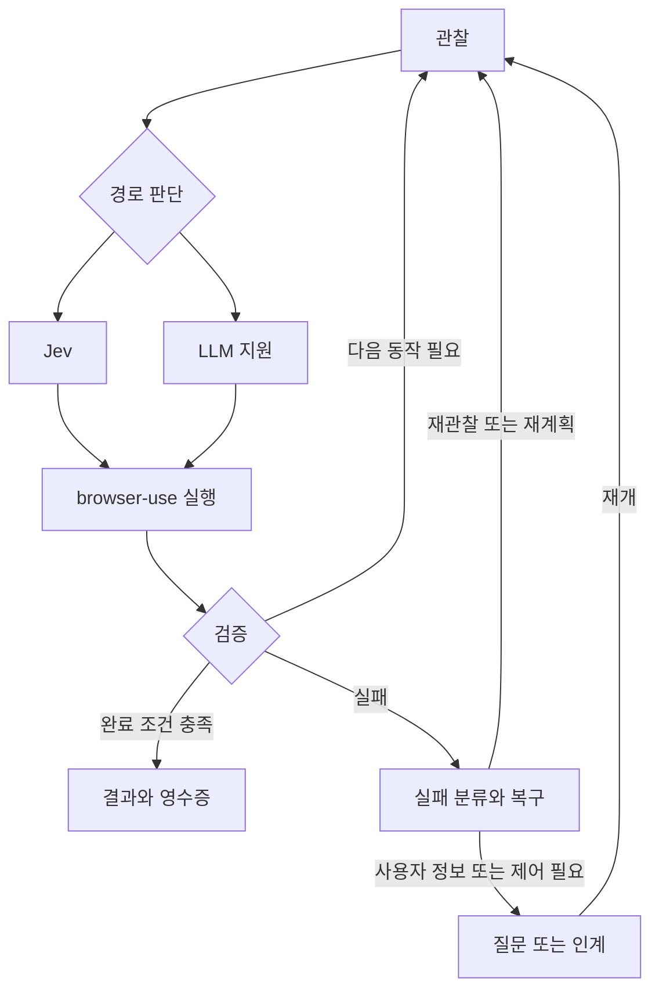

# JevPilot

**자연어로 브라우저 작업을 맡기고, 화면 근거로 결과를 확인합니다.**

JevPilot는 Jev를 우선 사용하는 브라우저 에이전트입니다.
상태가 명확하면 Jev가 다음 동작을 고릅니다.
도움이 필요하면 LLM이 입력값 생성, 대상 선택, 재계획, 답 추출을 돕습니다.
브라우저 관찰과 동작 실행은 **browser-use**를 사용합니다.
기본 제품 경로는 **jev-adaptive**입니다.

> [!IMPORTANT]
> 이 프로젝트는 연구용 구현입니다. 비교 평가에서 우위를 주장하지 않습니다.
> 구독의 실제 청구액은 **미확인**입니다. API 환산액은 실제 청구액이 아닙니다.

## 목차

- [빠른 시작](#빠른-시작)
- [작업 실행](#작업-실행)
- [명령과 입력](#명령과-입력)
- [실행 구조](#실행-구조)
- [영수증 읽기](#영수증-읽기)
- [위험 동작 처리](#위험-동작-처리)
- [평가 결과](#평가-결과)
- [제한 사항](#제한-사항)
- [직접 구현한 부분](#직접-구현한-부분)
- [사용한 오픈소스](#사용한-오픈소스)
- [개발과 기존 실행 경로](#개발과-기존-실행-경로)

## 빠른 시작

### 준비

Python **3.12 이상**, uv, 로컬 Chrome 또는 Chromium이 필요합니다.
기본 실행은 브라우저 창을 표시합니다.
Linux나 WSL에서는 창을 표시할 수 있는 환경이 필요합니다.
ChatGPT 구독 경로를 쓰려면 공식 Codex CLI도 설치해야 합니다.

저장소 루트에서 실행합니다.

```bash
uv sync --extra dev
uv run jevpilot
```

### 첫 로그인

JevPilot 입력창에서 `/login`을 입력합니다.

```text
/login
```

| 메뉴 | 진행 순서 |
| --- | --- |
| `1) API 키` | OpenAI 또는 Anthropic을 고릅니다. 키를 입력하고 모델을 고릅니다. 인증 호출에 성공하면 저장합니다. |
| `2) 구독 로그인 (ChatGPT)` | 공식 Codex 로그인으로 인증합니다. 계정의 모델 목록에서 모델을 고릅니다. |
| `3) Jev API 키 등록/변경` | Jev(TypeSafe) 키를 등록하거나 바꿉니다. |

API 키 입력은 화면에 표시하지 않습니다.
키 검증은 실제 공급자 요청을 사용합니다.
API 경로 또는 구독 경로를 고른 뒤에도 **별도의 Jev 키**가 필요합니다.
Jev 키 입력을 건너뛰었다면 작업 전에 `/login`의 Jev 메뉴에서 등록합니다.
환경변수에 Jev 키가 있으면 그 값을 우선 사용합니다.

| 저장 위치 | 용도 |
| --- | --- |
| `~/.jevpilot/credentials.json` | API 키 |
| `~/.jevpilot/profile.json` | 인증 방식, 모델, 실행 정책 |
| `~/.jevpilot/codex/` | JevPilot 구독 경로의 Codex 인증 |
| `~/.jevpilot/chrome-profile/` | 작업용 브라우저 프로필 |
| `~/.jevpilot/runs/` | 실행 원장과 영수증 |

인증 파일과 브라우저 프로필을 공유하거나 커밋하지 마세요.
JevPilot는 구독 호출에 실패해도 유료 API로 자동 전환하지 않습니다.

### 환경변수

지원하는 설정은 [`.env.example`](.env.example)에 있습니다.
OpenAI, Anthropic, Jev 키는 각각 `JEVPILOT_OPENAI_API_KEY`,
`JEVPILOT_ANTHROPIC_API_KEY`, `JEVPILOT_JEV_API_KEY`를 사용합니다.
환경변수의 키가 저장된 키보다 우선합니다.
환경변수에 키만 넣어도 모델 선택이 생기지는 않습니다.
먼저 `/login`으로 프로필을 설정합니다.

`.env`를 사용한다면 같은 실행 명령에 `uv run --env-file .env`를 지정합니다.
`.env`는 자동으로 읽히지 않습니다.
기존 `.env`를 예제 파일로 덮어쓰지 마세요.

## 작업 실행

### 자연어 작업

로그인 후 입력창에 목표와 완료 조건을 씁니다.
여러 문장과 여러 줄을 하나의 작업으로 입력할 수 있습니다.

```text
docs.python.org에서 asyncio 문서를 여세요.
TaskGroup의 설명을 찾아 출처와 함께 알려 주세요.
```

자연어 작업은 LLM이 시작 주소와 완료 조건을 정리합니다.
필수 정보가 없으면 사용자에게 묻습니다.
모델의 완료 선언만으로 성공 처리하지 않습니다.
코드가 화면과 완료 조건을 대조합니다.

### 단일 작업 명령

`jevpilot task`는 셸 밖에서 작업을 실행합니다.
다음 예시는 **로컬 fixture 서버와 로그인된 프로필**이 필요합니다.
fixture는 `benchmarks/tasks/fixtures`에 있습니다.
이 폴더를 `http://127.0.0.1:8765`에서 제공한 뒤 실행합니다.

```bash
uv run jevpilot task "Aurora 상세 페이지를 여세요." \
  --start-url http://127.0.0.1:8765/filter.html \
  --verify-url-contains /items/aurora.html \
  --verify-text "Aurora details" \
  --headless
```

시작 주소와 완료 조건을 함께 주면 구조화 작업으로 실행합니다.
위 예시의 URL 조건은 **포함 여부**를 검사합니다.
텍스트 조건도 함께 통과해야 합니다.
`--headless`를 빼면 브라우저 창을 표시합니다.

> [!NOTE]
> fixture 서버가 없으면 위 예시는 성공하지 않습니다.
> 연결 거부 시 브라우저 로그에 `net::ERR_CONNECTION_REFUSED`가 나옵니다.
> 영수증에는 `결과: failed — navigation_failed`가 나오며 종료 코드는 `1`입니다.
> 로그인 전에는 서버 접속보다 먼저 `/login` 안내가 나옵니다.

| 추가 옵션 | 의미 |
| --- | --- |
| `task -` | 표준입력 전체를 작업으로 받습니다. 입력 종료 후 실행합니다. |
| `--value NAME=VALUE` | 작업에 필요한 입력값을 제공합니다. |
| `--output NAME` | 답에서 추출할 필드를 지정합니다. |
| `--approve-submit` | 비대화 실행에서 제출 확인을 승인합니다. 로그인·결제 인계를 해제하지 않습니다. |

표준입력으로 작업을 받으면 같은 입력을 실행 중 제어에 다시 쓰지 않습니다.
명령 옵션은 `uv run jevpilot task --help`로 확인합니다.

## 명령과 입력

| 명령 또는 키 | 동작 |
| --- | --- |
| `/login` | API 키, ChatGPT 구독, Jev 키를 설정합니다. |
| `/model` | 현재 인증 방식 안에서 모델을 바꿉니다. |
| `/fast`, `/fast on`, `/fast off` | 지원하는 구독 모델의 Fast 설정을 바꿉니다. |
| `Shift+Tab` | 지원하는 추론 강도를 순환합니다. 입력 중인 문장은 보존합니다. |
| `/stop`, `Ctrl-C` | 실행 중인 작업을 중단합니다. |
| `/handoff` | 실행 중에 브라우저 제어를 사용자에게 넘깁니다. |
| `/resume` | 사용자 인계를 마친 뒤 작업을 재개합니다. |
| `/help` | 명령과 입력 방법을 표시합니다. |
| `/exit` | 셸을 종료합니다. 실행 중이면 작업도 중단합니다. |
| `Ctrl+J`, `Alt+Enter` | 줄바꿈을 입력합니다. |
| `Enter` | 작업을 제출합니다. 여러 줄 붙여넣기도 지원합니다. |

모델과 인증 방식은 로그인 후에 선택할 수 있습니다.
추론 강도와 Fast 지원 여부는 공급자와 계정에 따라 다릅니다.
실행 중에는 `/stop`, `/handoff`, `/resume`으로 제어합니다.
확인 요청에는 `y/n`으로 답합니다.

## 실행 구조



JevPilot가 실행 루프를 소유합니다.
browser-use는 브라우저 세션, DOM 관찰, 동작 실행을 맡습니다.
기본 제품 루프 안에서 browser-use의 `Agent.run()`을 호출하지 않습니다.
평가의 LLM 중심 비교군만 이 루프를 사용합니다.
실패는 재관찰, 값 생성, 재계획, 사용자 질문으로 분류합니다.
단계 수, LLM 호출 수, 실행 시간에 제한을 두어 반복을 끝냅니다.

## 영수증 읽기

실행이 끝나면 결과, 근거, 구간 시간, 호출 수, 토큰과 비용을 표시합니다.
관찰, Jev, LLM, 실행, 대기·복구 시간을 구분합니다.
동시에 실행한 구간은 겹칠 수 있습니다.
구간 시간을 단순히 더한 값과 전체 시간이 같다고 가정하지 마세요.
Jev와 LLM 호출별 사용량도 실행 중에 출력합니다.
실행 중 `진행 #번호: 단계 시작 +경과초`와
`진행 #같은번호: 단계 완료 +경과초 · 소요 초`를 표시합니다.
작업 해석, 관찰, Jev 선택, 경로 판단, LLM 지원, 실행, 검증, 복구와 대기를
실제 발생 순서로 확인할 수 있습니다. 번호가 다른 구간은 병렬로 겹칠 수 있으므로
인접한 로그 두 줄의 간격이 아니라 같은 번호의 소요 시간을 읽으세요.

| 비용 표시 | 뜻 |
| --- | --- |
| `청구` | 공급자가 반환한 청구액입니다. |
| `추정` | 확인 가능한 사용량과 공개 API 단가로 계산한 값입니다. |
| `API 환산` | 구독 사용량을 API 단가로 환산한 참고값입니다. 실제 구독 청구액이 아닙니다. |
| `미확인` | 사용량, 단가 또는 청구액을 확인하지 못했습니다. 무료라는 뜻이 아닙니다. |

확인된 비용의 부분 합계는 전체 청구액이 아닙니다.
알 수 없는 모델 단가는 미확인으로 남깁니다.
평가에 사용한 구독의 실제 청구액과 API 환산액도 미확인입니다.
실행 기록은 `events.jsonl`과 `receipt.json`으로 저장합니다.
화면 인용과 실행 메타데이터에도 민감한 내용이 있을 수 있습니다.

## 위험 동작 처리

| 감지한 동작 | 기본 제품 경로의 처리 |
| --- | --- |
| 로그인, 비밀번호 입력 | 사용자에게 제어를 넘깁니다. |
| 예매, 주문, 신청, 제출 | 실행 전에 `y/n` 확인을 요청합니다. |
| 결제 | 항상 사용자에게 제어를 넘깁니다. |

사용자는 인계된 브라우저에서 직접 처리한 뒤 `/resume`으로 재개합니다.
가드는 관측된 레이블과 동작을 검사합니다.
모든 사이트의 위험을 찾아낸다는 보장은 없습니다.
자동화 차단 우회나 대기열 우회는 구현하지 않습니다.

## 평가 결과

> [!WARNING]
> **이 결과로 성능 우위를 주장하지 않습니다.**
> 표본이 작고 실행 시점과 브라우저 조건이 다릅니다.
> fixture 장애가 섞인 개발용 집계는 비교군 품질 지표로 제시하지 않습니다.
> 아래 결과도 [제한 사항](#제한-사항)과 함께 읽어야 합니다.

### 비교군

| 비교군 | 이름 | 역할 |
| --- | --- | --- |
| A | `llm-centric` | browser-use Agent가 LLM 중심으로 실행합니다. |
| B | `jev-centric` | Jev 중심으로 실행합니다. 작업 정리, 필요한 값 생성, 답 추출에는 LLM을 사용합니다. |
| C | `jev-adaptive` | **제품 기본 경로**입니다. 상태에 따라 LLM 지원을 선택합니다. |
| D | `jev-ultrafast-ref` | 외부 jev-ultrafast의 **참고 결과**입니다. JevPilot의 성과가 아닙니다. |

### 별도 평가용 작업: holdout

| 비교군 | 예정·기록된 실행 | 평가 가능한 실행 | 독립 검증 통과 / 평가 가능한 실행 |
| --- | ---: | ---: | ---: |
| A | 20 | 10 | 0/10 |
| B | 20 | 10 | 5/10 |
| C | 20 | 10 | 5/10 |
| D | 20 | 10 | 0/10 |

**수치 출처:** `evaluation/results/browser-use-eval-v1/REPORT-v2.md`,
`## holdout` 집계표.
각 비교군에서 사이트 차단과 검증 불가 실행을 분모에서 제외했습니다.
예정·기록된 실행에는 제외된 실행도 남아 있습니다.
원문의 신뢰구간과 실행별 내역도 함께 확인하세요.
보고서는 저장소 상위 작업 폴더에 보관합니다.
이 worktree의 Git 추적 파일에는 포함하지 않습니다.

### 원본과 수정 평가

원본은 `evaluation/results/browser-use-eval-v1/REPORT.md`에 보존했습니다.
원본 A의 `agent_step` 호출은 **46/46**에서 `provider_unavailable`을 기록했습니다.
진단에서는 Codex strict-schema의 필수 키 누락으로 요청이 거부된 사실을 확인했습니다.
모든 과거 호출에서 원시 거부 응답을 직접 확보했다는 뜻은 아닙니다.
이 결과를 A의 측정 성능으로 해석하지 않습니다.

`8bd7f3c`는 strict-schema를 수정했습니다.
`2c47f2d`는 통합 실패 분류를 수정했습니다.
승인된 재실행의 A와 기존 B/C/D를 선택한 결과가 `REPORT-v2.md`입니다.
원본 결과는 교체하거나 삭제하지 않았습니다.
이 경위의 출처는 `REPORT-v2.md`의
`## Arm A invalidation and authorized replacement`입니다.

## 제한 사항

- **fixture 서버 장애:** 첫 개발용 캠페인이 충돌하면서 fixture 서버도 종료됐습니다.
  B/C/D의 F-02~F-05 결과가 이 장애의 영향을 받았습니다.
  직접 살펴본 F-02 r03의 C와 D는 `chrome-error`의 `ERR_EMPTY_RESPONSE`로 끝났습니다.
  서버 로그는 캠페인 충돌 시점에 멈췄습니다.
  나머지 실패한 fixture 실행도 같은 원인으로 추정하지만 개별 확인은 하지 않았습니다.
  사용자는 재실행하지 않기로 결정했습니다.
  따라서 fixture 비율과 이를 포함한 개발용 집계를 측정된 비교군 품질로 제시하지 않습니다.
  이 추가 한계와 결정의 출처는 사용자 확인 사항입니다.
- **안전 조건 차이:** A와 D에는 위험 동작 가드가 없습니다.
  가드 유무가 다른 결과를 같은 안전 조건의 실험으로 해석하지 마세요.
- **브라우저 조건 차이:** D는 다른 Browser Harness 계층과
  **1120x780** viewport를 사용합니다.
  A/B/C는 browser-use와 **1280x800** viewport를 사용합니다.
  출처는 `REPORT-v2.md`의 `## Observed browser conditions`입니다.
- **설명되지 않은 H-3:** 모든 비교군의 독립 검증 결과는 **0/5**입니다.
  B/C가 `verified`를 보고한 실행도 있지만 독립 검증은 통과하지 못했습니다.
  원인은 설명되지 않았습니다.
  출처는 `REPORT-v2.md`의 holdout `### Scenarios`, H-3 행입니다.
- **평가할 수 없었던 작업:** H-2는 사이트 차단으로 평가 가능한 실행이 없습니다.
  H-4는 부분 시간표만으로 첫 출발을 증명할 수 없어 평가 가능한 실행이 없습니다.
  출처는 `REPORT-v2.md`의 `## Blocked and unverifiable observations`입니다.
- **작은 표본과 시점 차이:** 반복 표본이 작습니다.
  A 재실행과 B/C/D 실행은 동시에 진행하지 않았습니다.
  사이트 상태, 네트워크, 공급자 응답 시간의 변화를 제거하지 못했습니다.
- **비용 비교:** 구독의 실제 청구액은 미확인입니다.
  공개 단가 추정이나 API 환산을 실제 청구액으로 바꾸어 해석하지 마세요.
  시간과 비용을 절감하려는 목표와 그 목표를 입증한 결과를 구분합니다.

## 직접 구현한 부분

| 구현 | 담당 범위 |
| --- | --- |
| Jev 우선 실행 루프 | 관찰과 후보를 바탕으로 동작을 고르고 실행 순서를 관리합니다. |
| 적응형 개입 정책 | 상태, 선택 신호, 반복 실패에 따라 LLM 지원을 선택합니다. |
| 실패 분류와 복구 | 재관찰, 값 생성, 재계획, 사용자 질문·인계로 나눕니다. |
| 코드 검증 | 완료 조건, 화면 인용, 추출값의 근거를 검사합니다. |
| 원장과 영수증 | 구간 시간, 호출, 토큰, 비용 의미를 기록합니다. |
| 로그인과 셸 UX | 인증 선택, 모델 선택, 여러 줄 입력, 실행 중 제어를 제공합니다. |
| 평가 하네스와 독립 검증기 | 비교군 실행, 실패 기록, 집계, 결과 검증을 수행합니다. |

## 사용한 오픈소스

| 구성 요소 | 버전·라이선스 | 사용 범위 |
| --- | --- | --- |
| browser-use | **0.13.11 · MIT** | 브라우저 세션, DOM 관찰, 동작 실행, `ChatOpenAI`·`ChatAnthropic` 공급자 클래스. 평가 A에는 Agent를 사용합니다. |
| jev-ultrafast | **MIT** | 평가 D에서 외부 프로그램으로 실행한 비교 참고입니다. 제품 코드에 사용하거나 복사하지 않았습니다. |
| Codex CLI | 공식 OpenAI CLI | ChatGPT 구독 로그인과 모델 호출에 사용합니다. 기본 전송은 상주 `app-server`입니다. |

browser-use는 **의존성으로만 사용**합니다.
버전은 `pyproject.toml`과 `uv.lock`에 고정했습니다.
브라우저 및 공급자 어댑터에서 공개 클래스를 호출합니다.
browser-use 소스는 저장소에 복사하지 않았습니다.
따라서 복사 코드용 `THIRD_PARTY_NOTICES.md`는 추가하지 않습니다.
설치된 browser-use 배포본의 MIT 고지는 해당 패키지에 포함됩니다.

Jev-ultrafast의 기능이나 참고 결과를 직접 구현한 성과로 표시하지 않습니다.
TypeSafe의 Jev API와 각 LLM 서비스는 외부 서비스입니다.
서비스 사용과 오픈소스 구현을 구분합니다.
JevPilot의 라이선스는 [MIT](LICENSE)입니다.

## 개발과 기존 실행 경로

일반 테스트는 실제 모델 API를 호출하지 않습니다.
설치 후 저장소 루트에서 실행합니다.

```bash
uv run python -m playwright install chromium
uv run pytest -q
```

기여 절차는 [CONTRIBUTING.md](CONTRIBUTING.md)를 참고하세요.
이 문서의 새 제품 경로는 `uv run jevpilot`, `jevpilot shell`, `jevpilot task`입니다.
`jevpilot run ...`은 **동결된 v1 경로**입니다.
v1의 `llm_only`·`jev_hybrid` 옵션은 새 셸의 기본 정책과 다릅니다.
기존 API는 `src/jevpilot/runtime.py`와 기존 하위 패키지에 남아 있습니다.
v1 옵션은 `uv run jevpilot run --help`로 확인합니다.
